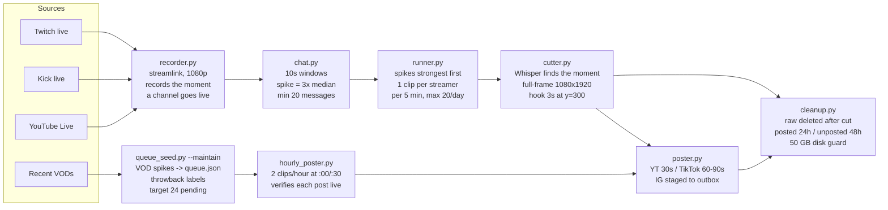
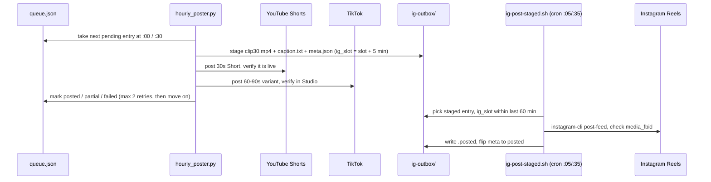
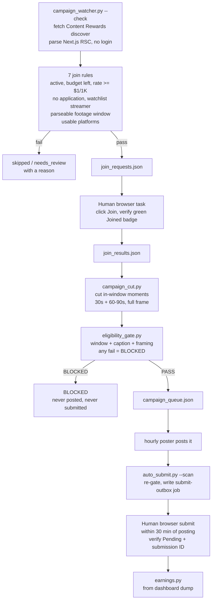

# clipsdaily


**77 pipeline modules · 7 CLI commands · 7 slash commands · 3 platforms · 2 clips/hour · 19 ADRs**

**Built by [Abel Prasad](https://www.linkedin.com/in/abel-prasad)** · [abelprasad.dev](https://abelprasad.dev)

<!-- STAR-HISTORY:START -->
[](https://star-history.com/#abelprasad/clipsdaily&Date)
<!-- STAR-HISTORY:END -->

Fully automatic clip pipeline for Twitch, Kick, and YouTube Live.
It records live streams, finds the moments chat erupts, cuts
30-second vertical clips, and posts them to YouTube Shorts,
TikTok, and Instagram Reels on an hourly cadence — no review
queue, no human step. General purpose: any streamer on the
watchlist, any game, any event.

It also joins and submits clipping campaigns (Content Rewards)
behind a strict eligibility gate, because one bad submission
bans the account from every campaign permanently.

> **This project is shut down as of Nov 17, 2026.** Abel killed it —
> see [`docs/RESTART.md`](docs/RESTART.md) for the shutdown state and
> how to bring it back. The repo is public (Abel's call) and stays
> under the ClipForge Proprietary License: read it, don't resell it.

> **This repo is the canonical dev copy** (decided Nov 15, 2026).
> All future clipsdaily work happens here. The live pipeline
> runs at `/home/abel/clipsdaily` on indra. Deploy with
> `bash deploy.sh` — never edit the live dir by hand.
> Nothing in this repo posts, joins, or submits anything until
> you configure auth and flip a platform on.

## Scope

Deliberate design decisions, not gaps.

### In scope

- Fully automatic live clipping: record, find chat spikes, cut, post — no review queue.
- Three destinations: YouTube Shorts (30s), TikTok (60–90s), Instagram Reels (30s).
- Campaign discovery + gated cutting + timed submission (Content Rewards).
- Full-frame vertical video, one-line captions, one big hook at the start.
- Kill switch + daily cap + disk guard + cleanup.
- A CLI, a Claude Code plugin, and a skill — so the pipeline is operable by a human, by Claude Code, or by a cron.

### Out of scope

- Review queues or per-clip approval — the pipeline is automatic by design.
- Paying to join any clipping platform — never.
- Posting to personal accounts — the clipsdaily accounts only.
- Live-money anything beyond campaigns — no trading, no gambling, no paid ads.
- YouTube VOD mode — paused, not built (design in `docs/youtube-vod-notes.md`).
- Rewriting the pipeline — the CLI is a thin entry layer over the existing modules.

## What it is

| Question | Answer |
|---|---|
| Sources | Twitch, Kick, YouTube Live (record-only for TikTok/Facebook Live) |
| Output | 1080x1920 vertical clips, full frame, nothing cropped |
| Destinations | YouTube Shorts (30s), TikTok (60–90s), Instagram Reels (30s) |
| Cadence | 2 clips/hour, every hour, until stopped |
| Review | None. Auto-post, kill switch (`STOP` file), daily cap (20) |
| Money | Campaigns on Content Rewards, ~$1 per 1,000 views, behind a hard gate |
| Accounts | Instagram @clippedaily31, TikTok @clips.daily548, YouTube Clips Daily @Clippedaily31. Never point this at a personal account. |

## Quickstart

```bash
# 1. Install the CLI (once the repo is pushed):
pipx install git+https://github.com/abelprasad/clipsdaily
# — or from a clone: git clone <repo> clipsdaily && cd clipsdaily && bash install.sh --local

# 2. System deps + config (from a clone):
bash setup.sh            # deps: ffmpeg, streamlink, whisper, posters
cp config/config.yaml.example config.yaml
cp config/campaigns.example.json campaigns.json   # starts empty; watcher fills it
# Auth: see docs/AUTH.md (YouTube OAuth, TikTok cookies, Instagram)
clipsdaily auth check        # read-only, posts nothing

# 3. Run (from the runtime home):
tmux new -s clipsdaily
clipsdaily run               # live recorder + poster
# Ctrl-B then D to detach
```

Start the other two sessions too (see
[Operations](#operations)):

```bash
tmux new -s clipsdaily-queue
clipsdaily queue maintain   # VOD-seeded hourly queue

tmux new -s clipsdaily-hourly
clipsdaily post hourly      # 2 clips/hour poster
```

Claude Code plugin — see [INSTALL.md](INSTALL.md):

```
/plugin marketplace add abelprasad/clipsdaily
/plugin install clipsdaily@abelprasad
```

## Architecture



### How a clip gets made

1. `recorder.py` — streamlink records a channel the moment it
   goes live, 1080p best, to `recordings/`.
2. `chat.py` — counts chat messages in 10-second windows
   (Twitch anonymous IRC, Kick public API + Pusher, YouTube
   yt-dlp live chat). A spike is 3x the recent median with at
   least 20 messages in the window. Intensity = messages /
   median.
3. `runner.py` — after a stream ends, spikes are processed
   **strongest first**, so when Whisper CPU queues back up the
   best clips go out first under the 20/day cap. Cooldown: max
   1 clip per streamer per 5 minutes, shared across platforms.
4. `cutter.py` — ffmpeg cuts 30s around each spike (20s before,
   10s after, because chat reacts after the moment). **Full
   frame**: the 16:9 source is scaled to fit a 1080x1920 canvas,
   top/bottom filled with a blurred, darkened copy. Nothing is
   cropped. One big hook line burns in at the start only (~3s,
   y=300). No word captions. Credit `clipsdaily • <streamer>`
   top-left.
5. `poster.py` — posts each finished clip to enabled platforms.
   TikTok gets only the 60–90s variant (Creator Rewards pays
   only for clips over 60s); Shorts/Reels get the 30s file.
6. `queue_seed.py` — maintainer that seeds the hourly queue from
   recent VODs (chat-spike ranking, throwback labels). This is
   what keeps the hourly feed full when no live stream is
   spiking.
7. `hourly_poster.py` — posts 2 clips/hour at :00 and :30
   (YouTube + TikTok from the pipeline host; Instagram staged
   to `ig-outbox/` for the operator-machine poster at :05/:35).
8. `vod.py` — VOD fallback: recover clips from a finished stream
   with TwitchDownloaderCLI chat + video.
9. `campaign_watcher.py` / `campaign_cut.py` /
   `eligibility_gate.py` / `auto_submit.py` / `earnings.py` —
   the money loop. See [Campaigns](#campaigns) and
   `docs/AUTOMATION.md`.

## Config

`config.yaml` (copy from `config/config.yaml.example`) controls
everything. The important knobs:

| Setting | Default | What it does |
|---|---|---|
| `streamers` | 10 entries | Watchlist. Twitch: kaicenat, ishowspeed, sykkuno, jynxzi, stableronaldo, zackrawrr, hasanabi, clix. Kick: xqc, adinross. xQc is watched on both with a shared cooldown, so the same moment never makes two clips. |
| `clip_length_seconds` | 30 | Shorts/Reels length. TikTok variant is 60–90s, target 75s. |
| `spike_threshold_multiplier` | 3.0 | Spike = 3x the recent median chat rate. |
| `spike_min_messages` | 20 | Floor per 10s window before a spike counts. |
| `spike_cooldown_seconds` | 300 | Max 1 clip per streamer per 5 min. |
| `max_clips_per_day` | 20 | Posting cap. |
| `whisper_model` | base | CPU-friendly. The queue maintainer uses `small` for better hooks. |
| `platforms` | all `false` | Turn a platform on ONLY after its auth is wired and `poster.py --check` reports it OK. |

Capacity: 8 concurrent recordings (8 cores, 11 GB RAM; Whisper
on CPU is the bottleneck, ~1 min per 30s clip). Edit
`config.yaml`, then restart the runner.

## Operations

### Processes (tmux, on the pipeline host)

| Session | Command | What it does |
|---|---|---|
| `clipsdaily` | `clipsdaily run` | Live loop: records live streams, detects spikes, cuts, posts via `poster.py`. |
| `clipsdaily-queue` | `clipsdaily queue maintain` | Maintainer: seeds the hourly queue from recent VODs, cuts 30s + TikTok variants. Target 24 pending. |
| `clipsdaily-hourly` | `clipsdaily post hourly` | Posts 2 clips/hour at :00 and :30 (YouTube + TikTok), stages Instagram to `ig-outbox/`. |

Start each in its own tmux session so it survives disconnects.
Restart by killing the session and starting a fresh one with the
same command — or use `bash deploy.sh` (see
[Dev workflow](#dev-workflow)). The runner and maintainer hold
their modules in memory: after editing `cutter.py`, `poster.py`,
or `queue_seed.py`, restart the affected sessions or the change
will not take effect. Do NOT use `restart_maintainer.py` — a
stale one-off that wipes `queue.json`.

### Hourly cadence



- 2 clips/hour: slots :00 and :30. YouTube + TikTok post from
  the pipeline host; Instagram is staged to
  `ig-outbox/<clip-id>/` and posted at :05/:35 by the
  operator-machine script `scripts/ig-post-staged.sh` (cron
  every 30 min, needs `instagram-cli`).
- Queue targets: seed ≥24 pending, keep cutting whenever
  pending drops below 12. 48 posts/day at full cadence.
- A platform marked FAILED in a slot is resolved, not retried
  forever — the entry must not sit "partial" forever and block
  the queue. Failed platforms do not retry indefinitely.

### Limits

- Max 20 clips/day (posting cap in `config.yaml`).
- Max 1 clip per streamer per 5 minutes (cooldown, shared
  across platforms).
- 8 concurrent recordings max (8 cores, 11 GB RAM).
- YouTube daily upload limit: observed Nov 15 (9th upload of
  the day failed with `uploadLimitExceeded`). Resets ~03:00
  EST. Staged clips wait for the next day.
- Disk guard: 50 GB free. Below it, the runner stops new
  recordings, finishes and posts what is queued, cleans up
  aggressively.

### Kill switch

`touch STOP` in the pipeline root pauses all posting
immediately. `rm STOP` resumes. The runner and hourly poster
both check for the file.

### Cleanup (cleanup.py, hourly + on startup)

- Raw recordings: deleted immediately after cutting (48h sweep
  is a crash backstop).
- Posted clips: deleted after 24h max. Unposted clips: max 48h.
- Temp files every run; logs older than 7 days deleted.
- Log: `logs/cleanup.log`. Manual run: `python -m clipsdaily.cleanup`.

### Crons (operator machine)

| Job | Schedule | What it does |
|---|---|---|
| Instagram poster | Every 30 min | `scripts/ig-post-staged.sh` — posts the most recently staged Reel, marks it posted on the host. Silent unless a post fails. |
| Auto-submit | Every 15 min | `scripts/submit_cron.sh` — scans the host for newly posted campaign clips (re-gating each), prints pending jobs; the operator submits each in the browser, verifies Pending + submission ID, marks via `scripts/submit_mark.sh`. |
| Campaign watch | Daily ~09:53 | `campaign_watcher.py --check` on the host; one browser task per join request (verify the green Joined badge). |
| Earnings | Daily ~21:53 | Browser dump of the submissions dashboard → `earnings_dump.json` on the host → `earnings.py --update` → one-line summary. |

Full install instructions: `docs/SUBMIT_CRON_BODY.md`.
Earnings dump format: `docs/earnings_dump_spec.md`.

### Logs

- `logs/runner-<date>.log`, `logs/hourly-<date>.log`,
  `logs/queue-<date>.log`, `logs/cleanup.log`,
  `logs/posted.jsonl`, `campaigns.log`, `campaign_cut.log`.
- Queue state: `queue/queue.json` (manifest) +
  `queue/state.json` (done spikes, VOD cursors). Never edit
  these by hand while the maintainer is running.

### VOD batch (manual)

```bash
python3 vod_batch.py   # latest completed VODs, top spikes, batch cap 6
python -m clipsdaily.vod https://www.twitch.tv/videos/<id> --max-clips 5
```

VOD clips are throwbacks: captions lead with
`Throwback — <streamer>: <moment>`. Old footage is a feature,
not a flaw. Do not submit VOD clips to Content Rewards unless
they are campaign clips that pass the gate.

## Campaigns

Content Rewards pays ~$1 per 1,000 views, min $10 at 10,000
views (MVR), max $500 per clip per platform, submit within 30
minutes of posting. **One bad submission bans the account from
EVERY campaign permanently.** `eligibility_gate.py` checks
window + caption + full-frame before any campaign clip is
queued or submitted; any failure or unverifiable check =
BLOCKED. Borderline = blocked. Never bypass it. Full rules:
`docs/campaigns.md`, `docs/AUTOMATION.md`.



> **Gap (Nov 15, 2026):** the hourly poster does NOT yet
> prefer `campaign_queue.json` when a campaign is active, so
> campaign cuts would sit unposted until that wiring lands.
> Do not assume a campaign clip is posted just because it was
> cut — check `campaign_queue.json` and post it explicitly.

## Standing rules

These were set by Abel across Nov 15, 2026. They supersede
everything earlier. Do not change them without his go. Full
text: `docs/CAPTIONS.md`.

- **Full frame, never crop.** Every clip is 1080x1920: the
  whole 16:9 source frame scaled to fit width, centered,
  top/bottom filled with a blurred, darkened copy. Nothing is
  cut off the sides. Applies to the queue, the runner, VOD
  batches, and campaign cuts. Already-posted cropped clips
  stay as-is; do not re-post duplicates to fix them.
- **One-line captions, no hashtags.** Same one-liner on all
  three platforms: `Throwback — <streamer>: <moment>`. No
  boilerplate, no date, no hashtags — hashtags do not drive
  reach in 2026 (categorization only). Campaign clips keep the
  money line + brand + destination + the one required hashtag
  (`#IShowSpeed`) and nothing else. Titles are not captions
  and are unchanged.
- **One big hook, start only.** One hook line at the START of
  the clip only (first ~3s), big bold centered text at y=300
  (moved down from y=150 to clear the platform top UI).
  Entrance 250ms ease-out-expo slide+fade, 170ms ease-in fade
  out. **No burned-in word captions, ever.** Whisper may run
  internally to find the moment; nothing burns in except the
  hook. Credit `clipsdaily • <streamer>` stays small,
  top-left.
- **The eligibility gate is the law.** Window + caption +
  full-frame, before queueing AND before submitting. Any
  failure or unverifiable check = BLOCKED. Borderline =
  blocked. Never bypass it for speed.
- **TikTok auto-posting is blocked (Nov 15, 2026).** The Japan
  70s clip posted fine at 19:33 EST, then every automated
  submit after ~20:25 was silently dropped. A manual post from
  a phone worked the same evening, so the account is fine —
  the automation session is throttled. Cookies are valid to
  May 2027. Do not hammer retries. Details + the open
  Playwright bug: `docs/TIKTOK.md`.
- **Never submit without the gate, twice, or past 30 min.**
  A submit job is only complete when the dashboard shows it
  Pending WITH a submission ID.
- **Credit the streamer in every post, and post only to the
  clipsdaily accounts** — never the personal account.

## Architecture decisions

The decisions behind the rules above live in the architecture decision log: [`docs/adr/README.md`](docs/adr/README.md). Fifteen ADRs, all decided Nov 15, 2026, in the Nygard template (Title, Status, Context, Decision, Consequences). ADRs are immutable: a changed decision gets a new ADR that supersedes the old one, never a rewrite.

## Dev workflow

### Repo vs live runtime

```mermaid
flowchart LR
    subgraph REPO["Dev copy — this repo (git)"]
        PY["*.py — pipeline code"]
        CFG["config/*.example"]
        DOC["docs/ + README + CLAUDE.md"]
        SCR["scripts/ (operator machine)"]
        SK["skills/motion-design"]
        DEP["deploy.sh"]
    end
    subgraph LIVE["Live runtime — /home/abel/clipsdaily on indra"]
        LPY["*.py (deployed copy)"]
        STATE["queue/ ig-outbox/ clips/\nvod/ recordings/ logs/\ncampaign_work/ submit-outbox/"]
        AUTH[".auth/ (0600)"]
        CONF["config.yaml campaigns.json"]
    end
    subgraph OP["Operator machine"]
        IGC["ig-post-staged.sh\ncron :05/:35"]
        SUBC["submit cron\n every 15 min"]
        BRW["browser tasks\njoin / submit / dumps"]
    end
    REPO -->|"deploy.sh: copy *.py,\nbackup live .py, restart tmux"| LIVE
    LIVE -->|"stages IG to ig-outbox/"| OP
    OP -->|"instagram-cli posts Reels"| IG2["Instagram"]
    LIVE -->|"posts"| YT2["YouTube / TikTok"]
```



### Why the queue (and other state) is not in the repo

`queue/`, `ig-outbox/`, `clips/`, `vod/`, `recordings/`,
`logs/`, `campaign_work/`, `submit-outbox/`, `.auth/`,
`config.yaml`, `campaigns.json`, `earnings.json`, and all
media are gitignored on purpose. They are **live state, not
code**:

- They change every minute (queue entries flip pending →
  posted, clips are cut and deleted within 24–48h).
- They contain real account data: submission IDs, video URLs,
  campaign state, auth tokens.
- Committing them would spam the history with throwaway
  state and risk leaking credentials.

The repo holds code + templates + docs. The live dir holds
state. A fresh clone recreates state by running `setup.sh`
(makes the empty dirs), copying the config examples, and
authenticating per `docs/AUTH.md`. Nothing is lost by leaving
state out — it is regenerated by running the pipeline.

### Deploying

```bash
bash deploy.sh --dry-run    # show what would change, change nothing
bash deploy.sh               # live deploy (run as abel on indra)
bash deploy.sh --no-restart  # copy files only, restart sessions yourself
```

What a live deploy does, in order:

1. Refuses if the repo has uncommitted changes (commit first)
   or if the live dir is missing `runner.py`.
2. Verifies every `.py` in the repo compiles.
3. Backs up the current live `.py` files to
   `~/clipsdaily-backups/<timestamp>/` on indra.
4. Copies `*.py` + `test_e2e.sh` from the repo to the live
   dir. State is never touched: no `queue/`, `ig-outbox/`,
   `.auth/`, `config.yaml`, or `campaigns.json`.
5. Restarts the three tmux sessions that are currently
   running (`clipsdaily`, `clipsdaily-queue`,
   `clipsdaily-hourly`) with the same commands they were
   started with. A session that is not running is skipped,
   not started — a stopped session may be deliberate.
6. Verifies the sessions and processes are back up.

Rollback: copy the backup `.py` files back to the live dir
and restart the sessions (the deploy output prints the exact
backup path).

### Workflow rules

- Work in this repo. Commit here. Deploy with `deploy.sh`.
- Never edit `/home/abel/clipsdaily/` by hand — it gets
  overwritten on the next deploy, and the change is lost.
- Never run `restart_maintainer.py` — stale, wipes `queue.json`.
- Long ffmpeg jobs run detached (nohup/tmux), never over a
  bare SSH pipe.

## Muse / Friday-specific dependencies

This repo was built by Muse (Friday) and some pieces only work
in that setup. A Claude Code (or any other agent) user must
replace them:

### 1. Instagram posting moved to indra (Nov 17, 2026) — then shut down

The VM route (`scripts/ig-post-staged.sh` with `instagram-cli`,
glibc 2.39 + a local privsep socket that only exists on the Muse
VM) stalled: every run asked for a one-time runtime approval and
overnight requests timed out while Abel slept, so nothing posted
for hours. The fix was `permissions.preapprove` (it refuses:
`not_preapprovable` for this method). **The IG poster moved to
indra Nov 17, 2026 — see `docs/AUTH.md` and `docs/RESTART.md`:**
a venv (`.venv-ig`, Python 3.13.18, `instagrapi==3.2.15`) with
`ig_post_staged.py`, a oneshot systemd service, and a timer
(`*:05,35`). Session-cookie import via `auth_ig_session.py`;
password login was never tested end to end. **Shutdown note: on
the same day Instagram flagged `@clippedaily31` for unoriginal
content (recommendations to non-followers off). Plain reposts must
not resume — see `docs/RESTART.md` for what counts as original.**

### 2. The operator crons assume Muse's scheduler

The IG 30-min poster, the auto-submit 15-min cron, the daily
campaign-watch, and the daily earnings cron were installed as
Muse scheduled jobs. They need the operator's own scheduler
(cron/systemd) plus a logged-in browser session for the
Content Rewards submits and dashboard dumps. Those steps are
**human-operated by design**: the browser task clicks Join,
submits clip links, and verifies Pending + submission ID.
`scripts/submit_cron.sh`, `scripts/submit_mark.sh`, and
`docs/SUBMIT_CRON_BODY.md` describe the loop; the schedule
itself is yours to install.

### 3. Auth must be recreated from scratch

`.auth/` is gitignored and was never copied. Recreate each
credential on the machine that will run the pipeline, per
`docs/AUTH.md`: YouTube OAuth via Google Cloud Console,
TikTok cookie export from the operator's browser, Instagram
via the Accounts Center link. `poster.py --check` verifies
auth without posting anything.

### 4. Hardcoded /home/abel paths

98 hardcoded `/home/abel` lines in 49 files (full table in
`docs/PATHS.md`), plus helper binaries expected at
`~/.local/bin/{ffmpeg,streamlink,yt-dlp,TwitchDownloaderCLI}`.
Either clone the repo to `/home/abel/clipsdaily` or edit the
listed lines. Do not refactor working code just for this.

## Troubleshooting

| Symptom | Likely cause | Fix |
|---|---|---|
| TikTok post: upload OK, Post clicked, no confirmation in 120s, video never appears | Automation session throttled by TikTok (not expired cookies — check `docs/TIKTOK.md`) | Stop retrying. Wait it out, or re-export cookies from the operator's browser and test once. A manual phone post working proves the account is fine. **Shutdown note (Nov 17, 2026): TikTok auto-posting is blocked account-wide since Nov 15.** |
| TikTok post fails with `Playwright Sync API inside the asyncio loop` | Code bug in the hourly poster (sync `TikTokUploader` inside an asyncio loop) | Fixed Nov 16, 2026: the TikTok post now runs in a subprocess (`post_tiktok_fixed.py`). **Shutdown note (Nov 17, 2026): TikTok auto-posting is blocked account-wide since Nov 15 — the fix is untested against a blocked account.** |
| YouTube upload fails with `uploadLimitExceeded` | YouTube daily upload limit | Wait for the reset (~03:00 EST). Staged clips post the next day. |
| YouTube delete fails with 403 insufficient scopes | Token has only `youtube.upload` + `youtube.readonly` | Re-run OAuth with the full `youtube` scope, or delete from YouTube Studio by hand. |
| Instagram Reel never posts | `ig-post-staged.sh` only picks entries with status `staged` and `ig_slot` within the last 60 min | Check `ig-outbox/<clip-id>/meta.json` status and `ig_slot`. The hourly poster re-stages on retry; a stale stage is skipped, not re-posted. |
| Clips cut but nothing posts | `STOP` file exists in the pipeline root | `rm STOP` to resume. |
| Runner/maintainer ignore your code change | They hold modules in memory | Restart the affected tmux session (or `bash deploy.sh`). |
| Whisper queue backs up, clips lag | CPU-bound (8 cores, 11 GB RAM) | Spikes are processed strongest-first by design. Do not raise concurrent recordings past 8. |
| Disk filling up | Raw recordings or unposted clips accumulating | `python -m clipsdaily.cleanup` manually; check the 50 GB disk guard in `cleanup.py`. |
| `poster.py --check` reports a platform NOT READY | Auth missing or expired for that platform | Recreate auth per `docs/AUTH.md`; TikTok needs a fresh cookie export when a post fails on auth. |
| Queue stuck on a `partial` entry | A platform failed and retries are exhausted | The entry moves on (max 2 retries). Check `logs/hourly-<date>.log` for the failure reason; do not hand-edit `queue.json` while the maintainer runs. |

## Repo map

| Path | What it is |
|---|---|
| `*.py` (repo root) | Pipeline code, flat copy of the live dir. Core: `runner.py`, `recorder.py`, `chat.py`, `cutter.py`, `poster.py`, `cleanup.py`, `vod.py`, `queue_seed.py`, `hourly_poster.py`, `campaign_watcher.py`, `campaigns.py`, `campaign_cut.py`, `eligibility_gate.py`, `auto_submit.py`, `earnings.py`, `auth_*.py`, `post_tiktok_fixed.py`, `ig_post_staged.py`. `patch_*.py`, `post_*.py`, `tt_*.py`, `recut_*.py` are historical one-offs, already applied — do not re-run blindly. `restart_maintainer.py` is stale and destructive (wipes `queue.json`) — **never run it**. |
| `deploy.sh` | Deploys this repo to the live dir: backup, copy `.py`, restart tmux. `--dry-run` prints the plan and changes nothing. |
| `config/` | `config.yaml.example`, `campaigns.example.json` (templates; copy to `config.yaml` / `campaigns.json`) |
| `scripts/` | Operator-machine helpers: `ig-post-staged.sh` (Instagram cron), `submit_cron.sh`, `submit_mark.sh` |
| `docs/` | `RESTART.md` (restart-from-scratch guide + shutdown state), `adr/` (architecture decision log, `adr/README.md` is the index), `AUTOMATION.md`, `CAPTIONS.md`, `campaigns.md`, `TIKTOK.md`, `AUTH.md`, `operations.md`, `PATHS.md`, `SUBMIT_CRON_BODY.md`, `earnings_dump_spec.md`, `youtube-vod-notes.md` |
| `skills/` | `motion-design/` (vendored, MIT) + install notes for `ffmpeg-skill` and `video-editing` |
| `assets/` | `clipsdaily-logo.jpg` (brand logo) |
| `clipforge-ads/` | ClipForge ads (Remotion) — merged in as a subtree, history preserved. Own README + ADRs under `clipforge-ads/docs/adr/`. |

## Path assumptions

Most core files resolve paths from their own location
(`Path(__file__).resolve().parent`), but several files hardcode
`/home/abel/clipsdaily` and the binaries live at
`~/.local/bin/{streamlink,yt-dlp,TwitchDownloaderCLI,ffmpeg}`.
See `docs/PATHS.md` for the exact list. Either clone to
`/home/abel/clipsdaily` or edit those paths. Do not refactor
working code just for this.

## What this repo is not

- Not the live pipeline. The live one runs on indra; this repo
  is where development happens, and `deploy.sh` ships it.
- Not a credential store. `.auth/` is gitignored. Recreate auth
  per `docs/AUTH.md`.
- Not a media archive. Clips, recordings, and logs are live
  state, deleted within 24–48h by design.
- The indra `README.md` from launch day is stale (pre-dates the
  full-frame rule and the caption cut-down) and is not included;
  this README supersedes it.
